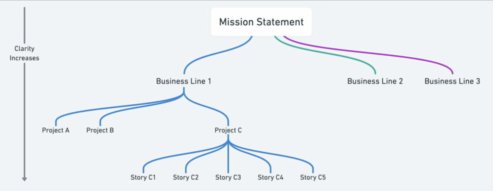

# AMBIGUITY

## Getting a shared understanding

- **ask questions**
  - open ended: wider understanding
  - close ended: specific and essential requirements
- **Use examples**: For each requirement that is not clear to you, ask users to walk you through a real example. While doing so, add more details to your requirement. If you use
- **User Stories**, examples will help you confirm or write down the **Acceptance Criteria**.
- **Replace or remove ambiguous words**: **Ask yourself the question “How can I test that requirement?”.** If your requirement contains words like “Easy to use”, “Robust”, “Faster”, “Many”, etc. how are you supposed to test and mark it as passed or failed? A classic example of an ambiguous requirement is “The system must have a USER-FRIENDLY user interface”. What is “USER-FRIENDLY” for John is not the same for Mary.
- **Ask WHY it’s important**: I recommend asking WHY whether the requirement is ambiguous or not. The WHY will give you more context and meaning as to why this requirement is so important to your users. I recently \*\*listened to a podcast explaining how our brain is
- **TDD/BDD**: evaluates the requirements in the acceptance criteria constantly looking for meaning subconsciously\*\*. The speaker was explaining that _if we don’t fully understand the meaning_ of a requirement, _our brain will make something up_. Which can be completely the opposite of what our user had in mind in the first place.
- **id possible risks**
  - accessibility
  - does this approach account for X scenario and how do we manage that?
  - collaborate on de scope or re prioritize
- **Use visual tools**

  - use case diagram: graphical representation of the interactions between an actor and a system
  - conceptual diagram: describes, at a business level, what are the main functionalities of the solution.
  - process flow diagram: is a simplified representation of a process.
  - entity relationship diagram: how entities relate to one another

- **Storytime Workshops**: _Elaborate and refine_ User Stories further during storytime workshops.
- **plan of execution**: formalize a product brief

## Steps to answer the question

1. Describe the project or task in detail
2. Explain how you approached the ambiguity or lack of specification.
3. Highlight any successes or achievements
4. Reflect on any lessons learned

## Tell me about a project or task that was ambiguous or underspecified?

- _(Search Results)_ - One project that was particularly ambiguous was when I was working on a team to redesign the company's search result page. We had a general idea of what we wanted the new page to look like, but there were a lot of details that were left up to us to figure out. To approach this ambiguity, I started by gathering feedback from the design team about what features and functionality we wanted to prioritize. I then created a rough wireframe of the page and presented it to the team for review and feedback. From there, we were able to refine the design and come up with a more detailed plan for how to proceed. Ultimately, the page redesign was a success and we received positive feedback from both internal and external stakeholders.

- (New Features/Components) I recently worked on a project for _AutoSuggestions_ of a search bar that was ambiguous in terms of its scope and timeline. We had a general idea of what the project entailed, but there were a lot of unknowns and variables that made it difficult to know how long it would take and what resources we would need. To handle this ambiguity, I worked closely with my team to identify any potential roadblocks or challenges that we might encounter. We also established regular check-ins to make sure that we were on track and that the needs were being met. Through effective communication and problem-solving, we were able to complete the project on a timely manner.

- **web component was uncertain**, Another project that was particularly ambiguous was when I was working on a team to create a component library using Web Components technologies. We were given a general idea of what the expectations were, but there were a lot of details that were left up to us to figure out. To approach this ambiguity, I started to schedule meetings with the purpose of writing a product brief that would depict different layers that provided not only a sense of progress, visualization and composition, but also allowed the team to provide immediate feedback, define the needs of the users, stakeholders and a clear definition of success for our finish line. Before and during the execution process I created meetings with the interested stakeholders to enable communication, specially with the borders around my team to make sure we were on track and that the needs of the end users were being met. Through effective communication, openness, problem-solving and clarity, we were able to complete the implementation of the foundation with the first twenty fully tested, accessible components and variations within a three tier approach.

## Resources

### User Stories

- SMART: Specific, Measurable, Achievable, Relevant, Time bound

### Getting off the ground

- see it as an opportunity because none knows what it ought to be and form it into something that is clear
- be an agent of driving clarity
- prioritize parts of the problem
- always operate with what the customers deem as success
- write a product brief (PRFAQ)
  - begin by fast forwarding to the end, yield customer segment and what they care about
    - what did we build?
    - for whom did we build it?
    - why are users excited about what came out?
- 

#### Product brief

- Be explicit about what your customers and their specific needs
- Write it down to force clarity of thought and to provide durability of ideas
- Be specific, RACI to identify stakeholders
- learn concepts
- think through the design models
- build the work architecture

### Project execution

- build: product
- measure: measure how its doing
- learn: what you should be doing differently

- keep eye out for surprises
- adapt
  - identify ambiguity
  - modify technical approach
  - execute
    ... wait
  - are we on track?

### Getting to done

- pick the finish line

### Manage you

- be an umbrella
- be thoughtful about your reaction
  - calm
  - reselient

### on the entire process

- work with everyone around you especially at the boarders of your project team to make sure plan makes sense to them
- decision should be first class and broadcasted
  - radiate intent, to get fastest feedback
- don't use email use a document, especially on long threads, context can be lost

## Resources

- https://leaddev.com/staffplus-new-york/video/driving-clarity-ambiguous-projects
